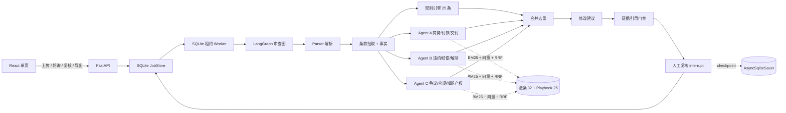

# 合同哨兵 ContractGuard

**面向中小企业采购合同的多 Agent + RAG 初审工具。**
上传一份中文货物采购合同，几分钟内得到带原文定位、法条依据和修改建议的风险清单；风险分为已核实/模型建议/待核实，已核实高风险必须人工复核后才能导出报告。

> AI 辅助合同初审 MVP（3 天核心开发）。示例合同全部为合成数据，输出不构成法律意见。

[演示](#演示) · [快速开始](#快速开始) · [架构](#架构) · [评测](#评测) · [设计取舍](#设计取舍) · [局限](#局限)

## 演示

https://github.com/user-attachments/assets/b6941557-3abe-4ff3-9e0f-8a1db5eda1ea

[▶ 演示页](https://lj105183000.github.io/ContractGuard/interview/) · [下载 1080p MP4](docs/interview/ContractGuard-demo-60s-1080p.mp4)

> 视频为 mock 模式界面录屏，不调用真实模型；若在非 github.com 镜像中无法播放，请打开演示页。

### 界面截图

<details>
<summary>展开 7 张界面截图</summary>

| 首页 | 风险清单 |
|---|---|
|  |  |

| 风险详情 | 法条与修改建议 |
|---|---|
|  |  |

| 批量审查 | 图内人工复核 |
|---|---|
|  |  |

| 合同修订稿 |
|---|
|  |

</details>

## 这是什么

中小企业通常没有专职法务，采购合同又高度模板化、风险集中在少数条款（付款、验收、违约、解除、管辖等）。漏审一份合同的代价，远高于初审成本。

ContractGuard 把采购合同初审拆成一条可解释的流水线：

```text
上传合同 → 解析/切条款 → 规则引擎 + 3 个 LLM 审查 Agent 并行
        → 合并去重 → 修改建议 → 证据/法条门禁 → 人工复核 → 报告
```

它不追求「万能合同助手」，只做**中文货物采购合同**这一种类型，把规则、法条、评测都围绕这个场景打磨。

### 核心能力

#### 审查能力

- **多 Agent 并行**：商务条款、违约解除、争议合规三个审查员同时工作；规则引擎作为确定性第四条分支。
- **规则 + LLM 双轨**：25 条确定性规则保召回，LLM 补语义与上下文；字段缺失时规则跳过而不是误报。
- **混合检索 RAG**：法条 + 企业 Playbook，BM25（jieba）+ 百炼 `text-embedding-v3` + RRF 融合。
- **可选 reranker**：支持 DashScope `gte-rerank`，默认关闭；未配置或调用失败时自动回退 RRF。
- **确定性置信分层**：按「规则实际命中 / 模型有证据和法条 / 证据或法条不足」分为已核实、模型建议、待核实；不使用模型自评分数。
- **引用门禁**：模型只能引用法条 ID，正文由后端从知识库渲染；合同证据必须逐字定位，否则降级为「需人工确认」。
- **人工复核闭环**：逐条采纳/忽略，记录复核意见；只有「已核实高风险」未处理时禁止导出，模型建议明确标注但不阻断。
- **图内 HITL**：存在已核实高风险时，LangGraph 在 `gate` 后 `interrupt` 暂停；用户逐条采纳/忽略，全部处理完后从 `AsyncSqliteSaver` checkpoint 恢复并完成。暂停任务跨后端重启仍可继续决策。
- **人工编辑与对比**：详情抽屉可编辑修改建议，修订稿会优先使用人工编辑文本；修订稿支持替换 diff 和原文/修订并排对比。
- **合同修订稿**：复核完成后可把已采纳建议自动落地为新合同文本，导出 DOCX + 逐条变更清单；模板建议原位标注，live 模型生成的完整条款才整条替换。
- **合同全文与报告预览**：条款导航、原文证据高亮、从风险卡片跳转到合同原文；报告可在导出前在线预览。
- **批量审查**：一次最多 3 份合同、最多 2 份并发；支持批次列表、批量复核已核实高风险和批次报告导出（前端 fan-out，不是服务端批次实体）。
- **扫描件 OCR**：无文字层的 PDF 与 JPG/PNG 图片走本地 RapidOCR（中英文），离线运行；结果会标注 OCR 置信度并提示人工核对。

#### 工程能力

- **多 LLM 路由与回退**：OpenAI 兼容 profiles 支持百炼、DeepSeek、Moonshot、OpenAI、Ollama/vLLM；可按任务分工，主模型失败自动切换备用模型。
- **完整前后端 + 桌面端**：FastAPI + React 单页，支持 PDF/DOCX/TXT/JPG/PNG、任务轮询、Word/Markdown/JSON 报告导出。
- **Electron 桌面端**：自动拉起本地后端，支持整窗拖拽、本地审查历史、系统托盘与完成通知；一键打包 Windows 安装包。
- **可复现评测**：8 份合成合同、51 个标注点，规则基线 P 100% / R 94.1% / F1 97.0%；full 模式结果按来源与置信分层披露误报归因。

#### 安全与可靠性

- **任务持久化与历史**：任务快照写入 SQLite；刷新页面或重启后端后，已完成任务仍可打开；`running` 崩溃会标记失败，`resuming` 由租约 reaper 最多重试 3 次。已结束任务可在历史面板主动删除（快照、源文件与 checkpoint 一并清理）。
- **任务生命周期**：排队/运行/待复核任务可在界面取消；失败/取消且源文件仍在的任务可重试。取消通过数据库标记 + worker 心跳生效，跨进程安全。
- **安全与配额**：可选单租户 Bearer Token；活跃任务上限、可选进程内限流、上传文件头校验、PDF 页数/DOCX 解压大小上限。

### 技术栈

| 层 | 选型 |
|---|---|
| 编排 | LangGraph 1.2（`StateGraph` + async 并行分支 + `interrupt`） |
| HITL 持久化 | `AsyncSqliteSaver`（独立 `checkpoints.sqlite3`） |
| 后端 | Python 3.12 / FastAPI / Pydantic v2 |
| LLM | OpenAI 兼容 Provider profiles（默认百炼 Qwen，可按任务路由到 DeepSeek/Moonshot/OpenAI/本地模型） |
| 向量 | `text-embedding-v3`，1024 维，本地 numpy 缓存 |
| 检索 | BM25（jieba + rank-bm25）+ 稠密向量 + RRF |
| 解析 | pypdf / pdfplumber / python-docx / pypdfium2 |
| 扫描件 OCR | RapidOCR 3 + onnxruntime（PP-OCRv6 模型，本地离线；许可见 RapidOCR 文档） |
| 报告 | Markdown / JSON / python-docx |
| 前端 | React 19 + Vite 7 + 手写 CSS |
| 桌面端 | Electron 45 + electron-builder 26 + PyInstaller |
| 部署 | Docker Compose（mock 单端口 demo） |
| 测试 | pytest（258 个离线测试） |

## 快速开始

以下命令默认在仓库根目录执行，mock 模式不需要 API Key。

```bash
cd backend && uv sync
uv run uvicorn app.main:app --reload --port 8000
```

```bash
cd frontend && npm install && npm run dev
```

打开 <http://localhost:5173>。或构建前端后单端口启动：

```bash
cd frontend && npm run build && cd ../backend && uv run uvicorn app.main:app --port 8000
```

完整环境、Docker、桌面端、live 模式、加密与测试见 [`docs/QUICKSTART.md`](docs/QUICKSTART.md)。

## 架构



### 请求生命周期

1. 前端 `POST /api/reviews` 上传文件，后端创建 `job_id` 并返回。
2. 上传完成后任务入队；SQLite 租约 worker 领取任务并执行 LangGraph（`SYNC_JOBS=1` 或关闭 worker 时退回进程内后台任务）。每个节点把进度事件写入 JobStore，并持久化到 SQLite 快照。
3. 前端每约 1 秒轮询 `GET /api/reviews/{id}`，渲染 Agent 时间线。
4. 图执行到 `gate` 后返回风险清单；如果有「已核实高风险」，`human_review` 节点 `interrupt` 暂停，任务变为 `awaiting_review`。用户在详情抽屉里逐条采纳/忽略，也可在「合同全文」里定位原文、在「报告预览」里查看草稿。
5. 所有已核实高风险处理完后，后端用 `Command(resume=...)` 从 checkpoint 恢复图；任务短暂变为 `resuming`，完成后变为 `completed`。暂停任务跨后端重启仍可继续决策。
6. 导出报告；后端只允许 `completed/completed_with_warnings` 导出，复核未完成返回 409。
7. 任务完成后可打开「修订稿」Tab：已采纳建议按替换/标注/补充条款落到新合同文本，并下载 DOCX + 变更清单。

### 三个 Agent 的分工

| Agent | 关注点 | 典型规则 |
|---|---|---|
| 商务条款审查员 | 价款、付款、交付、验收、质保 | 预付款过高、交付时间模糊、验收期过短 |
| 违约解除审查员 | 违约金、赔偿、解除、不可抗力 | 违约金过低、无限责任、买方无解除权 |
| 争议合规审查员 | 管辖、仲裁、保密、知识产权 | 管辖不利、诉讼仲裁并存、保密单向 |

三个 Agent 与规则引擎在**同一超步**并行；节点用 `async def` + `AsyncOpenAI`，保证 LLM HTTP 请求真正并发。

## RAG 与防幻觉

- **法条按「条」切块**，Playbook 按「条」切块，不按固定字数切碎。
- BM25 + 稠密向量各自召回，RRF 融合；语料仅 57 条文档，不引入向量数据库，用 numpy 精确检索。
- 可选 DashScope `gte-rerank` 重排（`RERANK_ENABLED=1`），默认关闭；接口失败或超时自动回退 RRF。
- 每条法条带 `id / 条号 / 生效日期 / 来源 URL`，正文只从知识库渲染；**模型不能生成法条原文**。
- 模型输出必须通过 Pydantic Schema；`evidence_quote` 必须是合同条款的子串，否则标记「需人工确认」。
- 法条 ID 必须存在于本轮检索上下文；不在上下文中的引用会被移除并记录。
- 合同视为不可信输入，prompt 明确要求忽略合同中的指令性文字。

## 知识库

| 内容 | 数量 | 说明 |
|---|---|---|
| 《民法典》合同编条文 | 31 条 | 合同内容、格式条款、履行、违约、买卖、验收、付款等 |
| 《民事诉讼法》第三十五条 | 1 条 | 协议管辖 |
| 企业采购 Playbook | 25 条 | 规则 DSL：条款缺失 / 字段比较 / 正则 / all·any·not |
| 合成采购合同 | 8 份（6 DOCX + 2 PDF） | 6 类风险画像 + 1 份较规范对照 |
| 评测标签 | 51 个 | 48 个规则可检出点 + 3 个语义点 |

法条来源与版本见 [`backend/data/legal/SOURCES.md`](backend/data/legal/SOURCES.md)。只做节选，不构成完整法律数据库。

## 评测

规则基线（8 份合成合同、51 个标注点，不需要 API Key）：

| 指标 | 规则基线 | live full |
|---|---:|---:|
| Precision | **100.0%** | **64.9%** |
| Recall | **94.1%** | **98.0%** |
| F1 | **97.0%** | **78.1%** |
| TP / FP / FN | 48 / 0 / 3 | 50 / 27 / 1 |
| 高风险 FP | 0 | 9 |
| 证据定位率 | 100.0% | 100.0% |
| 法条 ID 可解析率 | 100.0% | 100.0% |

- 规则层的 100% 是构造使然：51 个标注点中 48 个是规则可检出点；full 模式主要提升语义召回，但带来 27 个 advisory 误报，已核实层 P 100%、模型建议层 P 7.1%。
- 小样本、单标注者，**不能外推为真实泛化或法务准确率**。
- 完整诊断、检索/扰动/成本/消融、真实合同与门禁说明：[`docs/EVALUATION.md`](docs/EVALUATION.md)
- 原始报告：[`report_rules.md`](backend/eval/report_rules.md) · [`report_full.md`](backend/eval/report_full.md) · [`report_retrieval.md`](backend/eval/report_retrieval.md) · [`report_cost.md`](backend/eval/report_cost.md) · [`report_ablation.md`](backend/eval/report_ablation.md)

## 设计取舍

| 决策 | 为什么 | 代价 |
|---|---|---|
| LangGraph | 状态图、并行分支、节点可单测，技术代表性好 | 学习曲线；checkpointer 绑定 lifespan，不能缓存 |
| async 节点 | 同步节点在 LangGraph 中不会自动并发；async 才能让 3 个 Agent 真正并行 | 对初学者增加异步理解成本 |
| 规则 + LLM | 规则保确定性/召回，LLM 补语义 | 需要去重与冲突处理 |
| 确定性置信分层 | 只信规则实际命中、证据定位、法条校验；不把模型自评分当作可信度 | 只能分三档，不是概率校准 |
| 导出门禁只看已核实高风险 | 27 条模型高风险误报不应卡死演示；模型建议仍在报告中披露 | 导出结果可能包含未复核的模型建议，需读者自行判断 |
| 合同全文放入结果 | 前端一次拿到，条款定位、报告预览、历史快照共用一份数据 | polling/历史 JSON 变大，已加 gzip 与保存降级 |
| SQLite 快照 + 独立 checkpointer | JobStore 存任务/决策，checkpointer 存图状态；分开避免写锁 | 两个 SQLite 文件都含合同全文，需要保留期与清理 |
| 批量前端 fan-out + 后端批次视图 | 复用单文件审查接口，用 `batch_id` 聚合任务；后端提供批量决策/批次报告 | 批次仍需前端逐份提交，最多 3 份/2 并发；不是服务端批次实体 |
| reranker 默认关闭 | 避免默认依赖和延迟；失败回退 RRF | 不配置 DashScope Key 时不会启用 |
| 无向量数据库 | 57 条文档，numpy 足够；减少 Windows 依赖风险 | 语料扩大后需替换为 FAISS/pgvector |
| 轮询而非 SSE | 更简单、更好调试 | 实时性略差 |
| 图内 `interrupt` + SQLite checkpointer | 真正的暂停/恢复；默认开启，测试/smoke 关闭 | running 任务崩溃后不自动重放 LLM |
| SQLite 租约 worker + AES-GCM | 不引入 Redis/Celery，单机多进程也能安全领取任务；快照/checkpoint 可选加密 | 仍是单机 SQLite；密钥需人工管理，不支持在线轮换 |
| FastAPI + React | 完整前后端工程完整度更高 | 比 Streamlit 多花时间；因此砍掉路由/状态库/Tailwind |
| 法条只收 32 条 | 3 天内逐条核验来源，宁缺毋滥 | 覆盖面有限 |

## 目录结构

```text
contractguard/
├─ backend/
│  ├─ app/
│  │  ├─ main.py / config.py / schemas.py
│  │  ├─ worker.py                  # SQLite 租约 task worker（多进程安全）
│  │  ├─ crypto.py                  # JobState/checkpoint 的 AES-GCM 静态加密
│  │  ├─ provenance.py              # git/prompt/KB/合同哈希与路径脱敏
│  │  ├─ api/routes.py              # 上传、轮询、复核、导出
│  │  ├─ services/jobs.py           # SQLite 快照 JobStore + feedback v2 + retention
│  │  ├─ graph/                     # LangGraph 状态、human_review interrupt、checkpoint runtime
│  │  ├─ rag/                       # BM25、embedding、RRF、可选 DashScope rerank
│  │  ├─ rules/engine.py            # 规则 DSL 求值
│  │  ├─ services/confidence.py     # 确定性置信分层
│  │  ├─ parsing/                   # PDF/DOCX/TXT/图片解析、OCR、切分、事实
│  │  ├─ llm/                       # Provider profiles、路由/回退、prompt、trace
│  │  └─ reporting/                 # MD/JSON/DOCX 报告 + 合同修订稿
│  ├─ data/                         # 法条、Playbook、示例合同、llm_profiles.yaml
│  ├─ eval/                         # 标签、评测脚本、provenance、结果
│  ├─ scripts/                      # 生成数据、校验 KB/评测资产、反馈导出、备份、冒烟
│  └─ tests/                        # 258 个离线测试
├─ frontend/                        # React 单页
│  └─ src/components/               # ContractViewer / ReportPreview / RevisedContractView / BatchPanel
├─ desktop/                         # Electron 桌面端（主进程、preload、打包配置）
├─ docs/
│  ├─ CODE_GUIDE.md                 # 初学者代码导读
│  ├─ DATA_ASSETS.md                # 数据资产清单
│  ├─ DATA_GOVERNANCE.md            # Phase 0 数据治理策略
│  ├─ EVALUATION.md                 # 完整评测与诊断
│  ├─ LIMITATIONS.md                # 完整局限清单
│  ├─ QUICKSTART.md                 # 完整本地运行说明
│  ├─ REAL_CONTRACT_EVAL.md         # 真实合同作者标注外部效度
│  ├─ images/                       # 截图
│  └─ interview/                    # 60 秒演示视频与播放页
├─ .github/workflows/ci.yml         # 后端测试/覆盖率/依赖审计 + 评测门禁 + 前端构建 + 浏览器 E2E + Docker/HTTP smoke + Windows 桌面打包 smoke
├─ scripts/                         # Windows 启动脚本
├─ Dockerfile                       # 多阶段：前端构建 + 后端运行时
├─ docker-compose.yml               # mock 单端口 demo（127.0.0.1:8000）
├─ LICENSE
└─ README.md
```

## 常用 API

| 方法 | 路径 | 说明 |
|---|---|---|
| `POST` | `/api/reviews` | multipart 上传（字段 `file`，可选 `llm_route`/`batch_id`） |
| `POST` | `/api/reviews/samples/{id}` | 直接审查内置示例（可选 `llm_route`/`batch_id`） |
| `GET` | `/api/samples` | 内置示例列表 |
| `GET` | `/api/reviews` | 任务列表（可选 `status`/`limit`/`offset`/`batch_id`），不含全文 |
| `GET` | `/api/reviews/{job_id}` | 状态、事件、结果 |
| `POST` | `/api/reviews/{job_id}/findings/{finding_id}/decision` | 采纳/忽略；最后一条已核实高风险处理后自动 resume |
| `POST` | `/api/reviews/{job_id}/resume` | 手动触发 resume（用于重启后恢复） |
| `POST` | `/api/reviews/{job_id}/cancel` | 取消排队/运行/待复核任务 |
| `DELETE` | `/api/reviews/{job_id}` | 删除已完成/失败/取消任务的快照、源文件与 checkpoint；运行中/待复核返回 409 |
| `POST` | `/api/reviews/{job_id}/retry` | 重试 failed/cancelled 且源文件仍存在的任务 |
| `PATCH` | `/api/reviews/{job_id}/findings/{finding_id}/suggestion` | 人工编辑修改建议；修订稿优先使用 |
| `GET` | `/api/metrics` | 进程内请求/队列/worker 指标 |
| `GET` | `/api/batches/{batch_id}` | 批次状态、逐份任务摘要和门禁 |
| `POST` | `/api/batches/{batch_id}/decisions` | 批量采纳/忽略批次内已核实高风险 |
| `GET` | `/api/batches/{batch_id}/report/preview` | 批次报告预览 |
| `GET` | `/api/batches/{batch_id}/report?format=md\|json\|docx` | 批次报告导出；批次未完成时 409 |
| `GET` | `/api/reviews/{job_id}/report?format=md\|json\|docx` | 导出；复核未完成或已核实高风险未复核返回 409 |
| `GET` | `/api/reviews/{job_id}/report/preview` | 报告草稿预览；返回 Markdown 与导出门禁状态，不因未复核而 409 |
| `GET` | `/api/reviews/{job_id}/revised-contract?format=json\|md\|docx` | 按已采纳建议生成修订稿；门禁与报告导出一致 |
| `GET` | `/api/meta` | 法条/规则/示例数量、模型路由、模式、上传上限 |
| `GET` | `/api/health` | 健康检查 |

上传与示例审查接口支持可选查询参数 `?llm_route=<route_id>&batch_id=<id>`；可用路由与默认路由见 `/api/meta` 的 `llm_routes`/`llm_route`，批次 ID 可用 `GET /api/batches/{id}` 查看聚合结果。

交互式文档：<http://127.0.0.1:8000/docs>。

## 局限

- **合成数据与单一合同类型**：8 份合成合同、51 个标签，只做中文货物采购合同；不代表真实泛化。
- **法条与检索评测样本小**：32 条法条节选，检索/真实合同评测样本有限，不能外推为法务准确率。
- **解析与 OCR**：复杂表格、跨页版面、手写/低清晰度扫描件识别有限；条款超过 120 条时 LLM 抽取只处理前 120 条。
- **单机存储与并发**：SQLite 单表 + DB 租约 worker，适合单机低并发，不是分布式队列；无多用户/权限。
- **安全边界**：默认只接受本机 Host；单租户 Token，不是账号/角色/多租户；公网部署必须自行加 TLS/反代/共享限流。
- **不是法律意见**：所有高风险结论必须由具备法律知识的人员复核。

完整边界与参数说明见 [`docs/LIMITATIONS.md`](docs/LIMITATIONS.md)。

## Roadmap

1. **真实数据**：现有 3 份作者标注真实合同（仅 1 份 in-scope）；扩充到 10–30 份，并补第二标注者、盲测与裁决流程。
2. **检索增强**：本地 bge-reranker/ONNX、替换 numpy 为 FAISS/pgvector；在现有 recall/MRR 评测上补 nDCG、置信区间与独立相关性标注。
3. **HITL 生产化（基础版已完成）**：图内 interrupt/checkpointer、SQLite 租约 worker、租约回收与 resume 重试、checkpoint 加密与删除、任务取消/重试；剩余人工重放和分布式队列。
4. **部署与访问控制（基础版已完成）**：Docker Compose 单端口 mock demo，非 root 容器；可选单租户 Token、活跃任务上限和进程内限流。公网部署仍需 TLS/反代、共享限流和多用户权限。
5. **版面增强**：表格跨页、扫描件版面还原、条款 span 精确定位。
6. **评测扩展（部分完成）**：已加 bootstrap CI、nDCG、坏例回归、成本/延迟和扰动集；剩余独立标注/IAA、法条相关性人工评估、修改建议可用性评分。
7. **多合同类型**：劳动合同、租赁合同、服务合同，复用同一套规则/Agent 框架。

## 免责声明

本项目用于软件工程与 AI 应用演示，**不构成法律意见**。示例合同、公司名、金额、条款均为虚构。任何真实合同审查都应由具备相应资质的法律专业人员完成。

## 发布前检查

<details>
<summary>展开内部发布检查清单</summary>

- [ ] `backend/.env` 不在仓库；`git status` 里没有 Key、真实合同、`node_modules`、`dist`。
- [ ] 截图/录屏里没有 Key、终端敏感信息、真实合同。
- [ ] `LLM_MODE=mock uv run pytest -q --cov=app --cov-fail-under=80` 通过（当前 258 个离线测试，含默认 Worker+HITL E2E）；`eval/report_rules.md` 是真实运行结果。
- [ ] 已结束任务可通过历史面板或 `DELETE /api/reviews/{job_id}` 删除；快照、源文件、feedback、run trace 与 checkpoint 清理，运行中任务返回 409。
- [ ] `scripts/validate_kb.py`、`scripts/validate_eval_assets.py` 通过；`results_rules.json` 含 git/prompt/KB/dataset provenance。
- [ ] `scripts/export_feedback.py` 能导出 JSONL/CSV/SQLite 并报告 legacy/孤儿；真实合同公共 manifest 不含 filename/path/hash。
- [ ] `scripts/backup_db.py --include-feedback --include-traces --include-eval` 的 manifest 正确；恢复演练在停服务后完成。
- [ ] `ENCRYPTION_ENABLED=1` 时 feedback/run trace 不以明文落盘；`export_run_traces.py` 可用原密钥解密；桌面历史 `safeStorage` 可用时加密。
- [ ] 删除任务后 `data/audit/deletions.jsonl` 有最小墓碑；`scan_pii.py` 只输出计数。
- [ ] `WORKER_ENABLED=1` 下示例审查可完成；`ENCRYPTION_ENABLED=1` 时重启后仍能读取任务、HITL checkpoint 可恢复。
- [ ] 复核完成后「修订稿」Tab 能预览并下载 DOCX；MOCK 建议以 `【修订建议】` 标注而非直接改写原文。
- [ ] 设置 `CONTRACTGUARD_API_TOKEN` 时 Token 登录页可用，`/api/health` 仍返回 200；取消/重试流程可用。
- [ ] `CONTRACTGUARD_REQUIRE_AUTH=1` 且无 Token 时后端拒绝启动；`Host: attacker.example` 返回 400；`CORS_ORIGIN=*` 被拒绝。
- [ ] 超限上传返回 413；50MB TXT/海量条款/超大 PDF 页面/超像素图片/伪造 DOCX 解压大小被明确拒绝，正常五类文件与 OCR 通过。
- [ ] live 模式 embedding 不可达时 15s 内启动并降级 BM25；示例审查仍可完成。
- [ ] `scripts/smoke_api.py` 使用临时库，不清空真实任务数据；`scripts/backup_db.py` / `restore_db.py` 可备份并恢复 jobs/checkpoints；恢复前已停服务。
- [ ] `cd desktop && npm run dist` 可生成安装包；`desktop/release`、`backend/dist` 不入库，安装包内不含 `.env`。
- [ ] `docker-compose up --build` 后 `/api/health` 正常，示例审查可完成。
- [ ] Node 22 + uv 的干净环境按 README 可复现 mock 演示。
- [ ] 如果要写“live 模式评测”，先把真实跑出来的指标填进去；没跑就不写。
- [ ] CI 的 rules/检索/扰动/成本阈值全部通过；live full 只在发布前手工跑并归档。
- [ ] 如果对外声称真实合同质量：按 [`docs/ANNOTATION_GUIDE.md`](docs/ANNOTATION_GUIDE.md) 完成 20–30 份真实合同、双人盲标、裁决、fixed-universe IAA 和人工质量评分；否则只能写“合成集工程回归”。
- [ ] 需要消融结论时运行 `eval/run_ablation.py`，并区分 rules-only、full、no-RAG；不要用 HITL 冒充质量提升。

</details>

本次验收的实际命令与结果见 [`docs/LAUNCH_ACCEPTANCE.md`](docs/LAUNCH_ACCEPTANCE.md)。

## License

MIT 许可证，详见 [`LICENSE`](LICENSE)。真实合同 PDF、第三方法律文本与其他第三方素材不在授权范围内，也不随仓库分发；`backend/data/samples` 中的合同均为合成数据。

---

## English Abstract

<details>
<summary>展开英文摘要</summary>

**ContractGuard** is a 3-day MVP for Chinese goods-procurement contract review. It combines a deterministic 25-rule playbook with three parallel LangGraph LLM agents, hybrid RAG over 32 statutory articles and enterprise rules, citation/evidence gates, deterministic confidence tiers, human review, and DOCX/Markdown/JSON report export. Scanned PDFs and JPG/PNG images are parsed with local RapidOCR (offline, max 50 pages per scan) and flagged for manual verification. Chat calls are routed across OpenAI-compatible provider profiles (Qwen/DeepSeek/Moonshot/OpenAI/local) with per-task model preferences and ordered fallback chains. On a small synthetic benchmark of 8 contracts and 51 labeled risks, the rules-only baseline reaches 100% precision and 94.1% recall; a fresh live full-pipeline run (qwen-plus, 2026-11-02, deepseek-first fallback route) reached 98.0% recall and 64.9% precision (F1 78.1%) with 27 false positives; the confirmed tier reaches 100% precision while the advisory tier reaches 7.1%, which is disclosed in full and drives the confirmed/advisory/needs-review split. These figures follow deterministic fact-precedence, contract-level merge and contradiction-filter fixes validated by a fresh live run. The product also includes contract full-text navigation, in-app report preview, and status/search/sort filters. Job snapshots are persisted in SQLite behind a lease-based worker: completed jobs survive restarts, expired `resuming` work is retried up to three times, and `running` work is failed rather than replayed. Human-in-the-loop review is implemented with LangGraph `interrupt` and an `AsyncSqliteSaver` checkpoint so paused reviews survive restarts; optional AES-GCM encryption covers job state and checkpoints. The web UI supports up to three-file batch review with batch decisions and batch reports. Accepted findings can be turned into a revised contract draft (DOCX plus a change list): template suggestions are annotated inline, while complete clauses returned by a live model may replace the original clause. An optional DashScope reranker falls back to RRF when unavailable. Evaluation reports include contract-bootstrap 95% CIs, nDCG retrieval metrics with query-bootstrap CIs, known-badcase regression, deterministic perturbation stability checks, and a token/latency/cost summary with explicit price assumptions. The project deliberately trades breadth for a complete, explainable, testable loop.

> Built from scratch; no code was copied from reference projects.

</details>
