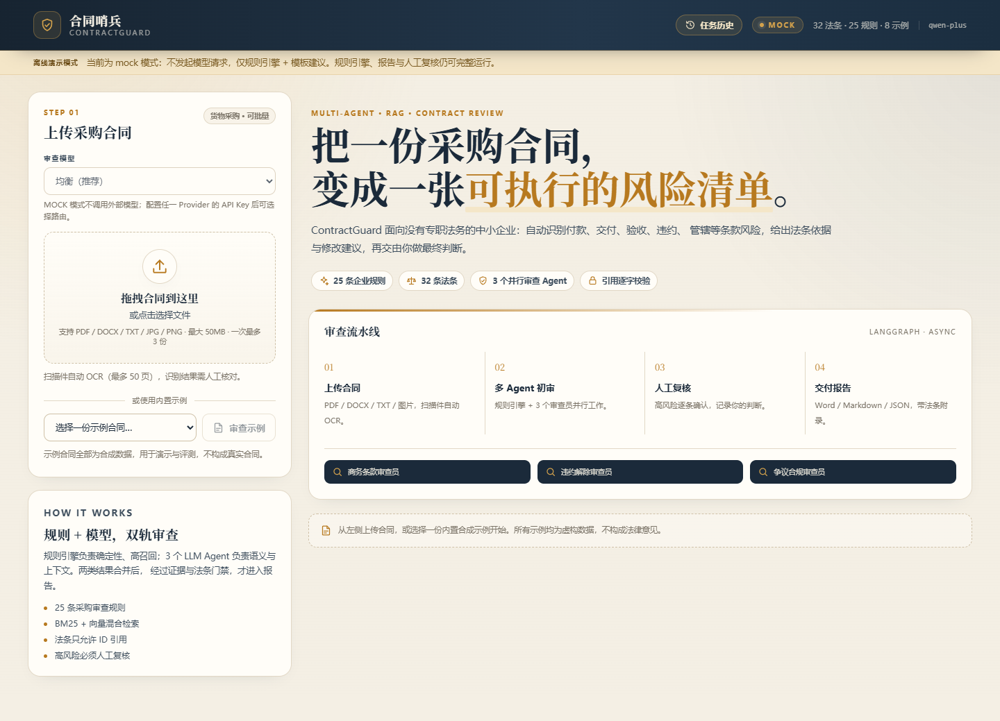
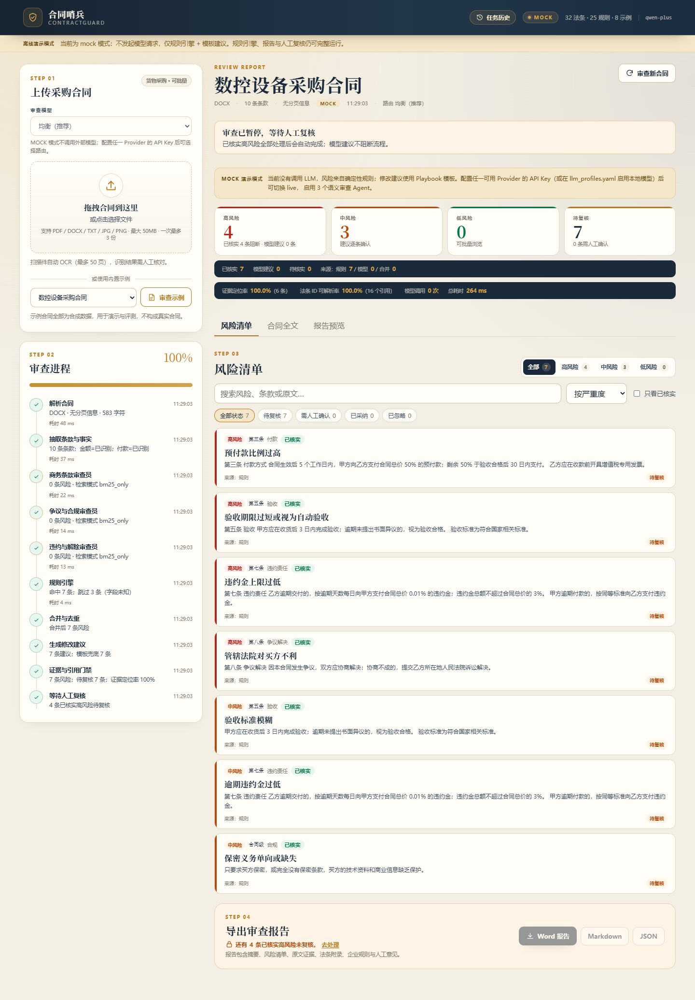
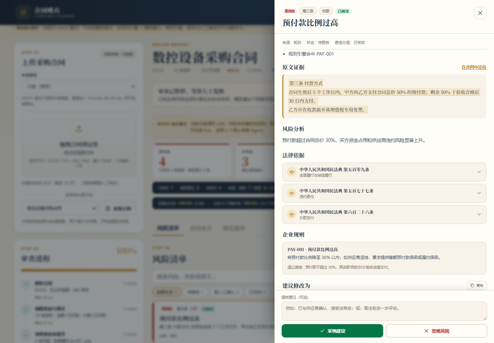
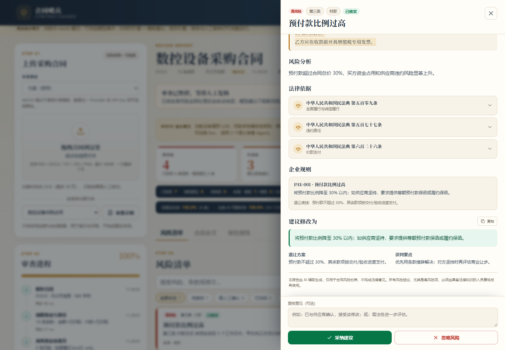
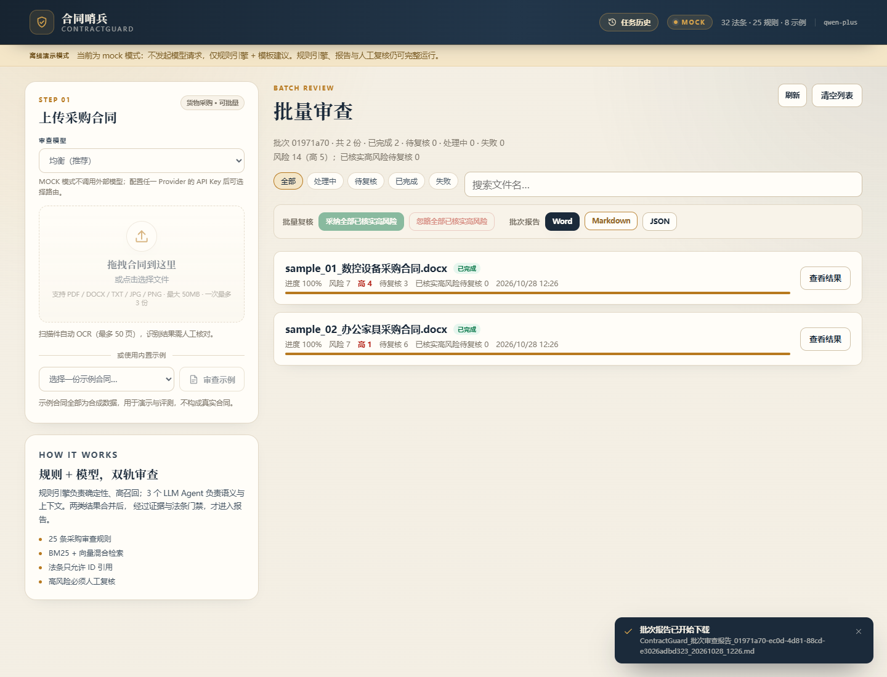
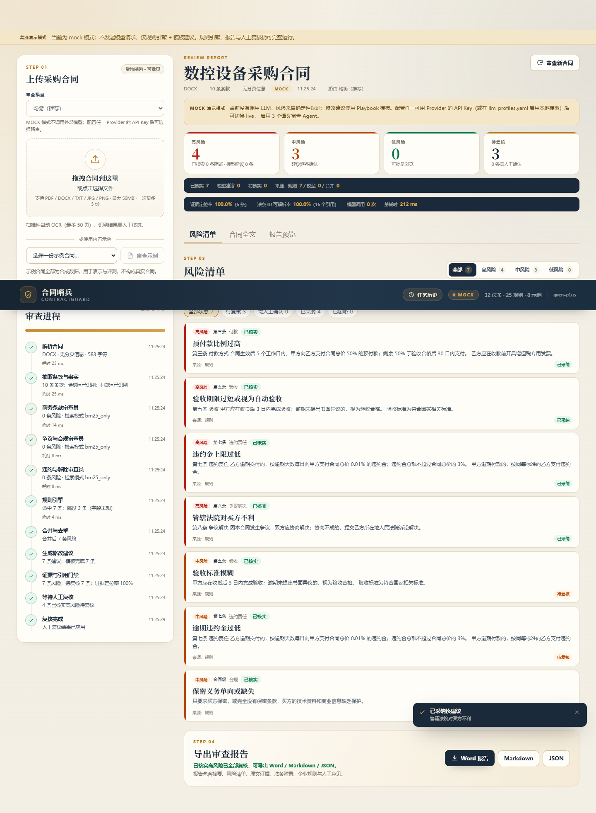
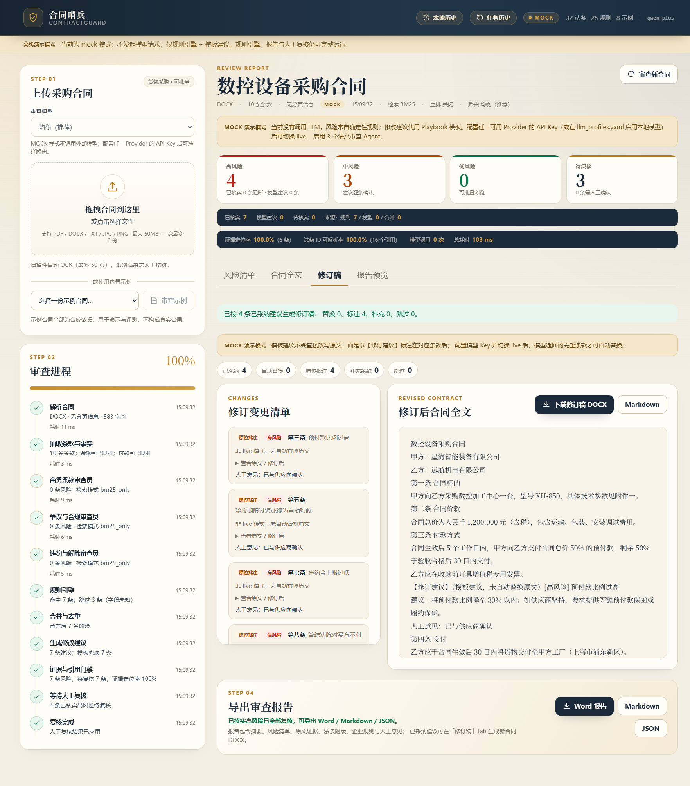
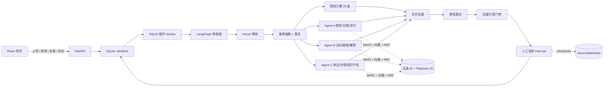

# 合同哨兵 ContractGuard

**面向中小企业采购合同的多 Agent + RAG 初审工具。**
上传一份中文货物采购合同，几分钟内得到带原文定位、法条依据和修改建议的风险清单；风险分为已核实/模型建议/待核实，已核实高风险必须人工复核后才能导出报告。

> AI 辅助合同初审 MVP（3 天核心开发）。示例合同全部为合成数据，输出不构成法律意见。

[快速开始](#快速开始) · [架构](#架构) · [评测](#评测) · [设计取舍](#设计取舍) · [局限](#局限)



## 这是什么

中小企业通常没有专职法务，采购合同又高度模板化、风险集中在少数条款（付款、验收、违约、解除、管辖等）。漏审一份合同的代价，远高于初审成本。

ContractGuard 把采购合同初审拆成一条可解释的流水线：

```text
上传合同 → 解析/切条款 → 规则引擎 + 3 个 LLM 审查 Agent 并行
        → 合并去重 → 修改建议 → 证据/法条门禁 → 人工复核 → 报告
```

它不追求「万能合同助手」，只做**中文货物采购合同**这一种类型，把规则、法条、评测都围绕这个场景打磨。

### 核心能力

- **多 Agent 并行**：商务条款、违约解除、争议合规三个审查员同时工作；规则引擎作为确定性第四条分支。
- **多 LLM 路由与回退**：OpenAI 兼容 profiles 支持百炼、DeepSeek、Moonshot、OpenAI、Ollama/vLLM；可按任务分工，主模型失败自动切换备用模型。
- **混合检索 RAG**：法条 + 企业 Playbook，BM25（jieba）+ 百炼 `text-embedding-v3` + RRF 融合。
- **规则 + LLM 双轨**：25 条确定性规则保召回，LLM 补语义与上下文；字段缺失时规则跳过而不是误报。
- **确定性置信分层**：按「规则实际命中 / 模型有证据和法条 / 证据或法条不足」分为已核实、模型建议、待核实；不使用模型自评分数。
- **引用门禁**：模型只能引用法条 ID，正文由后端从知识库渲染；合同证据必须逐字定位，否则降级为「需人工确认」。
- **人工复核闭环**：逐条采纳/忽略，记录复核意见；只有「已核实高风险」未处理时禁止导出，模型建议明确标注但不阻断。
- **合同修订稿**：复核完成后可把已采纳建议自动落地为新合同文本，导出 DOCX + 逐条变更清单；模板建议原位标注，live 模型生成的完整条款才整条替换。
- **合同全文与报告预览**：条款导航、原文证据高亮、从风险卡片跳转到合同原文；报告可在导出前在线预览。
- **可复现评测**：8 份合成合同、51 个标注点，规则基线 P 100% / R 94.1% / F1 97.0%；full 模式结果按来源与置信分层披露误报归因。
- **完整前后端 + 桌面端**：FastAPI + React 单页，支持 PDF/DOCX/TXT/JPG/PNG、任务轮询、Word/Markdown/JSON 报告导出。
- **任务持久化与历史**：任务快照写入 SQLite；刷新页面或重启后端后，已完成任务仍可打开；`running` 崩溃会标记失败，`resuming` 由租约 reaper 最多重试 3 次。
- **任务生命周期**：排队/运行/待复核任务可在界面取消；失败/取消且源文件仍在的任务可重试。取消通过数据库标记 + worker 心跳生效，跨进程安全。
- **安全与配额**：可选单租户 Bearer Token；活跃任务上限、可选进程内限流、上传文件头校验、PDF 页数/DOCX 解压大小上限。
- **人工编辑与对比**：详情抽屉可编辑修改建议，修订稿会优先使用人工编辑文本；修订稿支持替换 diff 和原文/修订并排对比。
- **图内 HITL**：存在已核实高风险时，LangGraph 在 `gate` 后 `interrupt` 暂停；用户逐条采纳/忽略，全部处理完后从 `AsyncSqliteSaver` checkpoint 恢复并完成。暂停任务跨后端重启仍可继续决策。
- **批量审查**：一次最多 3 份合同、最多 2 份并发；支持批次列表、批量复核已核实高风险和批次报告导出（前端 fan-out，不是服务端批次实体）。
- **可选 reranker**：支持 DashScope `gte-rerank`，默认关闭；未配置或调用失败时自动回退 RRF。
- **扫描件 OCR**：无文字层的 PDF 与 JPG/PNG 图片走本地 RapidOCR（中英文），离线运行；结果会标注 OCR 置信度并提示人工核对。
- **Electron 桌面端**：自动拉起本地后端，支持整窗拖拽、本地审查历史、系统托盘与完成通知；一键打包 Windows 安装包。

### 技术栈

| 层 | 选型 |
|---|---|
| 编排 | LangGraph 1.2（`StateGraph` + async 并行分支 + `interrupt`） |
| HITL 持久化 | `AsyncSqliteSaver`（独立 `checkpoints.sqlite3`） |
| 后端 | Python 3.12 / FastAPI / Pydantic v2 |
| LLM | OpenAI 兼容 Provider profiles（默认百炼 Qwen，可按任务路由到 DeepSeek/Moonshot/OpenAI/本地模型） |
| 向量 | `text-embedding-v3`，1024 维，本地 numpy 缓存 |
| 检索 | BM25（jieba + rank-bm25）+ 稠密向量 + RRF |
| 解析 | pypdf / pdfplumber / python-docx / pypdfium2 |
| 扫描件 OCR | RapidOCR 3 + onnxruntime（PP-OCRv6 模型，本地离线；许可见 RapidOCR 文档） |
| 报告 | Markdown / JSON / python-docx |
| 前端 | React 19 + Vite 7 + 手写 CSS |
| 桌面端 | Electron 45 + electron-builder 26 + PyInstaller |
| 部署 | Docker Compose（mock 单端口 demo） |
| 测试 | pytest（177 个离线测试） |

## 截图

| 风险清单 | 风险详情 |
|---|---|
|  |  |

| 法条与修改建议 |
|---|
|  |

| 批量审查 | 图内人工复核 |
|---|---|
|  |  |

| 合同修订稿 |
|---|
|  |

## 快速开始

### 环境

- Windows 10/11（其它系统也可，启动脚本是 `.bat`，命令可手动执行）
- [uv](https://docs.astral.sh/uv/)（会用项目里的 `.python-version` 安装 Python 3.12）
- Node.js 18+（Web 前端；桌面端依赖 Electron 45，需要 Node.js 22.12+，本项目用 Node 24 验证）
- 扫描件 OCR 由 RapidOCR + onnxruntime 提供，随 `uv sync` 安装；模型已打包，无需 Tesseract 或联网下载
- Docker Desktop（可选，用于 `docker-compose up --build` 容器化演示）

### 1. 启动后端（默认 mock，不需要 API Key）

```bash
cd backend
uv sync
uv run uvicorn app.main:app --reload --port 8000
```

或双击 `scripts\start_backend.bat`。

### 2. 启动前端（开发模式）

```bash
cd frontend
npm install
npm run dev
```

打开 <http://localhost:5173>。或双击 `scripts\start_frontend.bat`。

### 3. 单端口演示（可选）

```bash
cd frontend
npm run build
cd ../backend
uv run uvicorn app.main:app --port 8000
```

打开 <http://127.0.0.1:8000>。或直接双击 `scripts\start_demo.bat`。

### 4. 桌面端（可选）

```bash
cd desktop
npm install
npm run dev
```

或双击 `scripts\start_desktop.bat`。桌面端会自动启动后端并加载界面；支持整窗拖拽、本地历史、托盘与完成通知。关闭窗口只是隐藏到托盘，托盘菜单「退出」才会结束后端。

打包 Windows 安装包：

```bash
cd desktop
npm run dist
# 产物：desktop/release/ContractGuard-Setup-<version>.exe
```

细节、数据目录与 live 配置位置见 [`desktop/README.md`](desktop/README.md)。

### 5. Docker（mock，一键启动）

```bash
docker-compose up --build
```

打开 <http://127.0.0.1:8000>。若 8000 被占用，可用 `CONTRACTGUARD_PORT=8001 docker-compose up --build`。镜像内自带法条、Playbook、示例合同和前端构建产物，默认 `LLM_MODE=mock`、`HITL_ENABLED=1`、`WORKER_ENABLED=1`，只绑定 localhost。容器 entrypoint 会修正 named volume 权限后以非 root `appuser` 运行 uvicorn；任务 SQLite、checkpoint SQLite 与上传源文件都保存在 named volume `contractguard-data`：`docker-compose down/up` 不丢暂停任务和已完成任务，`docker-compose down -v` 才会清空。若要 live，可在 `docker-compose.yml` 取消 `DASHSCOPE_API_KEY` 注释并设置 `LLM_MODE=live`。公网部署前必须自行加鉴权/限流。

### 6. 切换到 live（调用真实模型）

1. 注册[阿里云百炼](https://bailian.console.aliyun.com/)，开通 `qwen-plus` 与 `text-embedding-v3`（也可以换成其它 OpenAI 兼容 Provider）。
2. 复制配置：

   ```bash
   cd backend
   copy .env.example .env        # Windows cmd
   # 或 cp .env.example .env    # Git Bash
   ```

3. 编辑 `backend/.env`：

   ```dotenv
   LLM_MODE=live
   DASHSCOPE_API_KEY=sk-你的Key
   # 可选：其它 Provider
   DEEPSEEK_API_KEY=sk-...
   OPENAI_API_KEY=sk-...
   # 可选：指定默认路由
   LLM_ROUTE=balanced
   ```

4. 查看/编辑 [`backend/data/llm_profiles.yaml`](backend/data/llm_profiles.yaml)：providers 只写环境变量名，routes 定义 `default` 回退链和 `tasks` 任务优先链。默认 `balanced` 已验证可用；`deepseek-first`、`quality`、`local` 等路由按需启用。

5. 重启后端。首次请求会自动构建向量缓存；也可以预构建：

   ```bash
   uv run python scripts/build_kb.py --embeddings
   ```

6. 页面右上角应从 `MOCK` 变为 `LIVE`，左侧「审查模型」下拉可选择路由；结果头部会显示实际路由和模型。8 份合同全量评测预计花费几元人民币以内，以百炼账单为准。

> 不要把 `.env` 提交到 git。没有可用 Provider Key 时系统会明确降级为 mock，不会静默伪造 LLM 结果。
>
> 聊天模型失败时按 profiles 的顺序自动回退；每个 profile 最多尝试 2 次，`LLM_TIMEOUT_S`/`LLM_DEADLINE_S` 控制单次请求与总时限。Embedding 仍单独配置：可用 `EMBEDDING_API_KEY`/`EMBEDDING_BASE_URL` 指向另一个 OpenAI 兼容服务，未配置时回退 BM25。

### 7. 可靠性与静态加密（可选）

后端默认启用 SQLite 租约 worker：上传完成后任务入队，worker 用 DB CAS 领取，同一任务只会被一个进程执行；执行期间心跳续租，进程崩溃后过期租约由 reaper 回收。`resuming` 任务最多重试 3 次；`running` 任务不会自动重放 LLM（避免重复计费），会标记为失败。

```dotenv
WORKER_ENABLED=1
WORKER_CONCURRENCY=2
WORKER_POLL_INTERVAL_S=1.0
LEASE_SECONDS=60
HEARTBEAT_SECONDS=15
```

需要多进程时可以 `uv run uvicorn app.main:app --workers 2`：每个进程都会启动自己的 worker/reaper，靠 SQLite 租约协调。SQLite 适合单机低并发，不是高吞吐队列；解析/OCR 在线程池执行，但大 PDF/OCR 仍会消耗 CPU/内存并拉长任务时间，必要时调大 `LEASE_SECONDS`。

静态加密默认关闭，开启后 `jobs.state_json`（含合同全文）与 LangGraph checkpoint 使用 AES-GCM 加密：

```dotenv
ENCRYPTION_ENABLED=1
CONTRACTGUARD_MASTER_KEY=<至少 16 字符的随机值>
```

生成密钥：`python -c "import secrets; print(secrets.token_urlsafe(32))"`。旧的明文记录仍可读；主密钥丢失后无法解密，不支持在线轮换。关闭加密不会解密已有数据，旧库需要保持密钥或清空重建。任务列表的 filename/summary/error、上传临时文件和桌面端历史快照仍是明文。

可选单租户鉴权与配额：

```dotenv
CONTRACTGUARD_API_TOKEN=<随机 Token>   # 留空关闭鉴权
MAX_ACTIVE_JOBS=20
RATE_LIMIT_PER_MINUTE=0                # 0 关闭；进程内滑动窗口
PDF_MAX_PAGES=200
DOCX_MAX_UNCOMPRESSED_MB=200
```

设置 Token 后，除 `/api/health` 外的 API 都要求 `Authorization: Bearer <token>`；前端会弹出 Token 登录页。限流是单进程内存实现，多进程/公网部署仍应在反向代理层做共享限流。上传会校验 PDF/DOCX/PNG/JPEG 文件头，并限制 PDF 页数与 DOCX 解压大小。

备份/恢复（先停止服务再恢复）：

```bash
cd backend
uv run python scripts/backup_db.py --output-dir backups --include-uploads
uv run python scripts/restore_db.py --backup-dir backups/20261028_120000 --include-uploads --yes
```

备份使用 SQLite 在线 backup API；`--include-uploads` 会复制上传源文件。加密库恢复时必须提供原 `CONTRACTGUARD_MASTER_KEY`。

### 8. 测试与评测

```bash
cd backend
uv run pytest -q
uv run python scripts/validate_kb.py
uv run python scripts/test_live_offline.py     # 本地假 OpenAI，验证 live + 模型回退，不需要 Key
uv run python eval/run_eval.py --mode rules   # 无需 Key
uv run python eval/run_eval.py --mode full    # 需要 live Key
uv run python eval/run_retrieval_eval.py --no-rerank
uv run python eval/run_perturbation_eval.py   # 无需 Key
uv run python eval/run_cost_report.py         # 读取已落盘 full 结果
```

## 架构



### 请求生命周期

1. 前端 `POST /api/reviews` 上传文件，后端创建 `job_id` 并返回。
2. 上传完成后任务入队；SQLite 租约 worker 领取任务并执行 LangGraph（`SYNC_JOBS=1` 或关闭 worker 时退回进程内后台任务）。每个节点把进度事件写入 JobStore，并持久化到 SQLite 快照。
3. 前端每约 1 秒轮询 `GET /api/reviews/{id}`，渲染 Agent 时间线。
4. 图执行到 `gate` 后返回风险清单；如果有「已核实高风险」，`human_review` 节点 `interrupt` 暂停，任务变为 `awaiting_review`。用户在详情抽屉里逐条采纳/忽略，也可在「合同全文」里定位原文、在「报告预览」里查看草稿。
5. 所有已核实高风险处理完后，后端用 `Command(resume=...)` 从 checkpoint 恢复图；任务短暂变为 `resuming`，完成后变为 `completed`。暂停任务跨后端重启仍可继续决策。
6. 导出报告；后端只允许 `completed/completed_with_warnings` 导出，复核未完成返回 409。
7. 任务完成后可打开「修订稿」Tab：已采纳建议按替换/标注/补充条款落到新合同文本，并下载 DOCX + 变更清单。

### 三个 Agent 的分工

| Agent | 关注点 | 典型规则 |
|---|---|---|
| 商务条款审查员 | 价款、付款、交付、验收、质保 | 预付款过高、交付时间模糊、验收期过短 |
| 违约解除审查员 | 违约金、赔偿、解除、不可抗力 | 违约金过低、无限责任、买方无解除权 |
| 争议合规审查员 | 管辖、仲裁、保密、知识产权 | 管辖不利、诉讼仲裁并存、保密单向 |

三个 Agent 与规则引擎在**同一超步**并行；节点用 `async def` + `AsyncOpenAI`，保证 LLM HTTP 请求真正并发。

## RAG 与防幻觉

- **法条按「条」切块**，Playbook 按「条」切块，不按固定字数切碎。
- BM25 + 稠密向量各自召回，RRF 融合；语料仅 57 条文档，不引入向量数据库，用 numpy 精确检索。
- 可选 DashScope `gte-rerank` 重排（`RERANK_ENABLED=1`），默认关闭；接口失败或超时自动回退 RRF。
- 每条法条带 `id / 条号 / 生效日期 / 来源 URL`，正文只从知识库渲染；**模型不能生成法条原文**。
- 模型输出必须通过 Pydantic Schema；`evidence_quote` 必须是合同条款的子串，否则标记「需人工确认」。
- 法条 ID 必须存在于本轮检索上下文；不在上下文中的引用会被移除并记录。
- 合同视为不可信输入，prompt 明确要求忽略合同中的指令性文字。

## 知识库

| 内容 | 数量 | 说明 |
|---|---|---|
| 《民法典》合同编条文 | 31 条 | 合同内容、格式条款、履行、违约、买卖、验收、付款等 |
| 《民事诉讼法》第三十五条 | 1 条 | 协议管辖 |
| 企业采购 Playbook | 25 条 | 规则 DSL：条款缺失 / 字段比较 / 正则 / all·any·not |
| 合成采购合同 | 8 份（6 DOCX + 2 PDF） | 6 类风险画像 + 1 份较规范对照 |
| 评测标签 | 51 个 | 48 个规则可检出点 + 3 个语义点 |

法条来源与版本见 [`backend/data/legal/SOURCES.md`](backend/data/legal/SOURCES.md)。只做节选，不构成完整法律数据库。

## 评测

规则基线（不需要 API Key，可复现）：

| 指标 | 值 |
|---|---|
| Precision | **100.0%** |
| Recall | **94.1%** |
| F1 | **97.0%** |
| TP / FP / FN | 48 / 0 / 3 |
| 95% CI（按合同 bootstrap） | P 100.0–100.0%；R 86.1–98.4%；F1 92.5–99.2% |
| 证据定位率（43 条） | 100.0% |
| 法条 ID 可解析率（111 个引用） | 100.0% |
| 平均耗时 | 0.03s / 份（仅规则） |

生成命令：

```bash
cd backend
uv run python eval/run_eval.py --mode rules
```

结果在 `backend/eval/results_rules.json` 与 `backend/eval/report_rules.md`。

全量 LLM 结果（live，qwen-plus，2026-10-28 实际运行）：

| 指标 | 值 |
|---|---|
| Precision | **56.8%** |
| Recall | **98.0%** |
| F1 | **71.9%** |
| TP / FP / FN | 50 / 38 / 1 |
| 95% CI（按合同 bootstrap） | P 43.9–65.9%；R 93.6–100.0%；F1 60.3–79.4% |
| 高风险 FP | 18 |
| 证据定位率（83 条） | 98.8% |
| 法条 ID 可解析率（189 个引用） | 100.0% |
| 平均耗时 | 87.0s / 份 |

38 个误报的归因：

- 按来源：36 个 `llm`、2 个 `rule+llm`，**没有纯规则误报**；
- 按等级：高 18 / 中 16 / 低 4；
- 按类别：合规 6、其他 6、争议 6、解除 5、质保 5、验收 3、知识产权 3、违约 2、交付 1、付款 1；
- 按 Agent：合规 21、商务 10、违约解除 7；
- 27 / 38 带 `rule_hint`，但这只是模型自报提示，**不等于规则引擎实际命中**；这也是置信分层只信规则实际命中的原因。

按置信分层：

| 分层 | TP | FP | Precision |
|---|---|---|---|
| 已核实（规则命中/规则+模型合并） | 48 | 2 | **96.0%** |
| 模型建议（有证据+法条，无规则佐证） | 2 | 34 | 5.6% |
| 待核实 | 0 | 2 | 0.0% |

> 这不是「真实泛化能力」：8 份合同、51 个标注点，其中 48 个是规则可检出点，规则基线接近满分是构造使然。full 模式相比 rules 只多命中 2 个语义点，却多出 38 个误报；二次去重把误报从上一版的 64 降到 38，但真正的质量差距仍在语义层：已核实层 P 96.0%，模型建议层只有 5.6%。因此系统把模型单独提出的高风险标为「模型建议」，不混进「已核实」层，也没有把它们从评测总数里删掉来美化 Precision。
>
> 法条 ID 可解析率只衡量引用 ID 是否存在于知识库（分母包含被移除的无效 ID），不等于法条相关性准确率；证据定位率的分母只包含提供了原文引用的风险，也不衡量分析质量。
>
> 本次 live 运行中有部分 `dashscope-turbo` 回退请求遇到 429，主模型 qwen-plus 完成；以上为实际落盘结果，未手工修改。
>
> 95% CI 是按合同 bootstrap（2000 次、seed=42）的描述性区间；8 份合同样本很小，区间很宽，不能解释为统计显著性。

### 检索评测

25 条作者构造的 query → 相关法条场景，语料 32 条法条，比较 BM25 / hybrid / rerank：

| 配置 | Hit@10 | Recall@10 | MRR@10 | nDCG@10 |
|---|---:|---:|---:|---:|
| BM25 | 80.0% | 50.0% | 0.505 | 0.419 |
| hybrid | 88.0% | 66.0% | 0.645 | 0.556 |
| BM25 + rerank | 84.0% | 58.0% | 0.664 | 0.532 |
| hybrid + rerank | 96.0% | 83.3% | 0.698 | 0.663 |

| 配置 | Recall@10 95% CI | nDCG@10 95% CI |
|---|---|---|
| BM25 | 37.3–62.0% | 30.1–53.7% |
| hybrid | 53.3–78.7% | 43.2–68.0% |
| BM25 + rerank | 45.3–71.3% | 41.1–65.2% |
| hybrid + rerank | 72.0–93.3% | 55.6–76.8% |

报告：[`backend/eval/report_retrieval.md`](backend/eval/report_retrieval.md)。query 与相关法条由作者构造，语料只有 32 条；CI 是按 query bootstrap 的描述性区间，不能外推为完整法律检索能力。

### 真实合同外部效度

另外用 3 份真实采购相关 PDF 做作者单人标注检查（非盲测、非独立法务标注）：

- R1（政府采购货物，唯一 in-scope）：rules 模式 TP/FP/FN = 2/3/2，Precision 40.0%、Recall 50.0%；只有 1 份 in-scope 合同，bootstrap CI 退化为点估计。
- R2（36 页施工合同，域外）与 R3（8 页 IT 采购，相邻域）只做定性观察，不与 R1 混合计算。
- 目前没有第二位独立标注者，`inter_annotator_agreement` 为 `null`；`eval/run_iaa.py` 和双人标注流程已就绪，但尚未有第二份标注数据。

报告：[`docs/REAL_CONTRACT_EVAL.md`](docs/REAL_CONTRACT_EVAL.md)。这也不是 benchmark，样本量和标注独立性都不足。

### 坏例回归与扰动稳定性

[`backend/eval/badcases.yaml`](backend/eval/badcases.yaml) + `tests/test_badcases.py` 固定了 rules 基线的已知坏例：48 TP / 0 FP / 3 已知语义 FN，以及“规则 findings 必须是已核实层”的约束。live 结果的已知误报标题也在 YAML 中披露。

文本级扰动（改名、金额格式、轻 OCR 噪声、条款倒序）结果：

| 版本 | TP | FP | FN | P | R | F1 |
|---|---:|---:|---:|---:|---:|---:|
| baseline | 48 | 0 | 3 | 100.0% | 94.1% | 97.0% |
| party_names | 48 | 0 | 3 | 100.0% | 94.1% | 97.0% |
| amount_formats | 48 | 0 | 3 | 100.0% | 94.1% | 97.0% |
| ocr_noise | 45 | 1 | 6 | 97.8% | 88.2% | 92.8% |
| reordered_clauses | 48 | 0 | 3 | 100.0% | 94.1% | 97.0% |

报告：[`backend/eval/report_perturbation.md`](backend/eval/report_perturbation.md)。这是规则层的小样本回归信号，不是真实 OCR/排版鲁棒性证明。

### 成本与延迟

从已落盘的 live full 结果统计（8 份合同）：

| 指标 | 值 |
|---|---|
| LLM 调用 | 98 次（失败 50，其中 429 = 48） |
| Token | 输入 112,491 / 输出 39,668 |
| 延迟 | mean 87.0s；p50 86.3s；p95 98.9s；max 100.1s |
| 估算费用 | ¥0.1693（8 份，约 ¥0.021/份） |

费用按**假设单价** ¥0.0008/1K input、¥0.002/1K output 计算，不是百炼账单，不含 embedding/rerank/重试；正式引用前用 `eval/run_cost_report.py --input-price-per-1k ... --output-price-per-1k ...` 按当期价格重算。报告：[`backend/eval/report_cost.md`](backend/eval/report_cost.md)。

## 设计取舍

| 决策 | 为什么 | 代价 |
|---|---|---|
| LangGraph | 状态图、并行分支、节点可单测，技术代表性好 | 学习曲线；checkpointer 绑定 lifespan，不能缓存 |
| async 节点 | 同步节点在 LangGraph 中不会自动并发；async 才能让 3 个 Agent 真正并行 | 对初学者增加异步理解成本 |
| 规则 + LLM | 规则保确定性/召回，LLM 补语义 | 需要去重与冲突处理 |
| 确定性置信分层 | 只信规则实际命中、证据定位、法条校验；不把模型自评分当作可信度 | 只能分三档，不是概率校准 |
| 导出门禁只看已核实高风险 | 27 条模型高风险误报不应卡死演示；模型建议仍在报告中披露 | 导出结果可能包含未复核的模型建议，需读者自行判断 |
| 合同全文放入结果 | 前端一次拿到，条款定位、报告预览、历史快照共用一份数据 | polling/历史 JSON 变大，已加 gzip 与保存降级 |
| SQLite 快照 + 独立 checkpointer | JobStore 存任务/决策，checkpointer 存图状态；分开避免写锁 | 两个 SQLite 文件都含合同全文，需要保留期与清理 |
| 批量前端 fan-out + 后端批次视图 | 复用单文件审查接口，用 `batch_id` 聚合任务；后端提供批量决策/批次报告 | 批次仍需前端逐份提交，最多 3 份/2 并发；不是服务端批次实体 |
| reranker 默认关闭 | 避免默认依赖和延迟；失败回退 RRF | 不配置 DashScope Key 时不会启用 |
| 无向量数据库 | 57 条文档，numpy 足够；减少 Windows 依赖风险 | 语料扩大后需替换为 FAISS/pgvector |
| 轮询而非 SSE | 更简单、更好调试 | 实时性略差 |
| 图内 `interrupt` + SQLite checkpointer | 真正的暂停/恢复；默认开启，测试/smoke 关闭 | running 任务崩溃后不自动重放 LLM |
| SQLite 租约 worker + AES-GCM | 不引入 Redis/Celery，单机多进程也能安全领取任务；快照/checkpoint 可选加密 | 仍是单机 SQLite；密钥需人工管理，不支持在线轮换 |
| FastAPI + React | 完整前后端工程完整度更高 | 比 Streamlit 多花时间；因此砍掉路由/状态库/Tailwind |
| 法条只收 32 条 | 3 天内逐条核验来源，宁缺毋滥 | 覆盖面有限 |

## 目录结构

```text
contractguard/
├─ backend/
│  ├─ app/
│  │  ├─ main.py / config.py / schemas.py
│  │  ├─ worker.py                  # SQLite 租约 task worker（多进程安全）
│  │  ├─ crypto.py                  # JobState/checkpoint 的 AES-GCM 静态加密
│  │  ├─ api/routes.py              # 上传、轮询、复核、导出
│  │  ├─ services/jobs.py           # SQLite 快照 JobStore + run_review/resume_review
│  │  ├─ graph/                     # LangGraph 状态、human_review interrupt、checkpoint runtime
│  │  ├─ rag/                       # BM25、embedding、RRF、可选 DashScope rerank
│  │  ├─ rules/engine.py            # 规则 DSL 求值
│  │  ├─ services/confidence.py     # 确定性置信分层
│  │  ├─ parsing/                   # PDF/DOCX/TXT/图片解析、OCR、切分、事实
│  │  ├─ llm/                       # Provider profiles、路由/回退、prompt、trace
│  │  └─ reporting/                 # MD/JSON/DOCX 报告 + 合同修订稿
│  ├─ data/                         # 法条、Playbook、示例合同、llm_profiles.yaml
│  ├─ eval/                         # 标签、评测脚本、结果
│  ├─ scripts/                      # 生成数据、校验 KB、冒烟
│  └─ tests/                        # 177 个离线测试
├─ frontend/                        # React 单页
│  └─ src/components/               # ContractViewer / ReportPreview / RevisedContractView / BatchPanel
├─ desktop/                         # Electron 桌面端（主进程、preload、打包配置）
├─ docs/
│  ├─ CODE_GUIDE.md                 # 初学者代码导读
│  ├─ REAL_CONTRACT_EVAL.md         # 真实合同作者标注外部效度
│  └─ images/                       # 截图
├─ .github/workflows/ci.yml         # 后端测试 + live-offline + KB + rules/retrieval/cost/perturbation + 前端构建
├─ scripts/                         # Windows 启动脚本
├─ Dockerfile                       # 多阶段：前端构建 + 后端运行时
├─ docker-compose.yml               # mock 单端口 demo（127.0.0.1:8000）
├─ LICENSE
└─ README.md
```

## 常用 API

| 方法 | 路径 | 说明 |
|---|---|---|
| `POST` | `/api/reviews` | multipart 上传（字段 `file`，可选 `llm_route`/`batch_id`） |
| `POST` | `/api/reviews/samples/{id}` | 直接审查内置示例（可选 `llm_route`/`batch_id`） |
| `GET` | `/api/samples` | 内置示例列表 |
| `GET` | `/api/reviews` | 任务列表（可选 `status`/`limit`/`offset`/`batch_id`），不含全文 |
| `GET` | `/api/reviews/{job_id}` | 状态、事件、结果 |
| `POST` | `/api/reviews/{job_id}/findings/{finding_id}/decision` | 采纳/忽略；最后一条已核实高风险处理后自动 resume |
| `POST` | `/api/reviews/{job_id}/resume` | 手动触发 resume（用于重启后恢复） |
| `POST` | `/api/reviews/{job_id}/cancel` | 取消排队/运行/待复核任务 |
| `POST` | `/api/reviews/{job_id}/retry` | 重试 failed/cancelled 且源文件仍存在的任务 |
| `PATCH` | `/api/reviews/{job_id}/findings/{finding_id}/suggestion` | 人工编辑修改建议；修订稿优先使用 |
| `GET` | `/api/metrics` | 进程内请求/队列/worker 指标 |
| `GET` | `/api/batches/{batch_id}` | 批次状态、逐份任务摘要和门禁 |
| `POST` | `/api/batches/{batch_id}/decisions` | 批量采纳/忽略批次内已核实高风险 |
| `GET` | `/api/batches/{batch_id}/report/preview` | 批次报告预览 |
| `GET` | `/api/batches/{batch_id}/report?format=md\|json\|docx` | 批次报告导出；批次未完成时 409 |
| `GET` | `/api/reviews/{job_id}/report?format=md\|json\|docx` | 导出；复核未完成或已核实高风险未复核返回 409 |
| `GET` | `/api/reviews/{job_id}/report/preview` | 报告草稿预览；返回 Markdown 与导出门禁状态，不因未复核而 409 |
| `GET` | `/api/reviews/{job_id}/revised-contract?format=json\|md\|docx` | 按已采纳建议生成修订稿；门禁与报告导出一致 |
| `GET` | `/api/meta` | 法条/规则/示例数量、模型路由、模式、上传上限 |
| `GET` | `/api/health` | 健康检查 |

上传与示例审查接口支持可选查询参数 `?llm_route=<route_id>&batch_id=<id>`；可用路由与默认路由见 `/api/meta` 的 `llm_routes`/`llm_route`，批次 ID 可用 `GET /api/batches/{id}` 查看聚合结果。

交互式文档：<http://127.0.0.1:8000/docs>。

## 局限

- **合成数据**：8 份合同、51 个标签，由作者与规则一起构造，存在设计偏差；不代表真实泛化。
- **单一合同类型**：只做中文货物采购合同；服务、劳动、租赁、涉外等不支持。
- **法条节选**：32 条，不含司法解释、地方规定；引用相关性未做大样本盲评。
- **多 LLM 回退成本**：主模型失败会按路由尝试备用模型，耗时可达成倍增加；traces 会记录每次尝试，默认每个 profile 最多 2 次。Embedding 不参与聊天路由，未配置 embedding 服务时只有 BM25。
- **条款抽取误差**：复杂表格、跨页版面、手写/低清晰度扫描件识别质量有限；OCR 文本仍需对照原件核对。
- **上传与解析**：默认上限 50MB，可用 `MAX_UPLOAD_MB` 调整；解析会把文件读入内存，超大 PDF/DOCX 更慢、更占内存。条款超过 120 条时 LLM 抽取只处理前 120 条，规则与启发式事实仍覆盖全文。
- **OCR 限制**：扫描件默认最多 OCR 50 页（`OCR_MAX_PAGES`），只做文字识别，不做版面还原/表格结构化；平均置信度和识别失败页数会写入运行提示。
- **任务存储与 worker**：SQLite 单表快照 + DB 租约 worker；上传完成后入队，多进程用 CAS 领取，心跳续租。进程崩溃后过期租约会被回收：`resuming` 最多重试 3 次，`running` 不自动重放 LLM，标记为失败。仍是单机 SQLite，不是高吞吐/分布式队列；无登录/多租户/权限，**不要直接暴露公网**。
- **Docker demo**：单容器、mock 模式、只绑定 `127.0.0.1`，默认开启 HITL 与 worker；任务 SQLite、checkpoint SQLite 与上传源文件都在 named volume `contractguard-data`，`down -v` 会清空；默认不启用鉴权，可配置单租户 Token，但没有多用户/权限，公网部署必须自行加保护。
- **HITL 限制**：图内 `interrupt` + `AsyncSqliteSaver`；暂停任务可跨重启恢复决策。完成/失败/过期任务的 checkpoint 会被删除；暂停任务的 checkpoint 按 `JOB_RETENTION_DAYS` 保留。`running/queued` 崩溃后不自动重放 LLM。
- **合同修订稿**：修订稿是基于解析后纯文本重新排版的 AI 草稿，不保留原 DOCX/PDF 的表格、页眉页脚、编号与页面样式；不生成 Word 修订痕迹（tracked changes）。MOCK/模板建议只做原位标注，不直接改写原文；同一条款多条建议全部标注；旧任务保守按模板处理。仍需法务逐条复核后才能作为正式合同使用。
- **静态加密边界**：`ENCRYPTION_ENABLED=1` 时只加密 `jobs.state_json` 与 checkpoint；任务列表的 filename/summary/error、上传临时文件和桌面端历史快照仍是明文。主密钥不支持轮换，丢失后旧数据无法解密。
- **鉴权/配额边界**：`CONTRACTGUARD_API_TOKEN` 是单租户共享 Token，不是账号/角色/多租户；限流和配额是单进程内存实现，多进程部署需在反向代理层补共享限流。`MAX_ACTIVE_JOBS` 包含待复核任务。
- **取消/重试边界**：取消通过 `cancel_requested` 标记 + worker 心跳生效，最长延迟一个心跳周期；上传任务失败后源文件通常已清理，此时重试返回 409，需要重新上传。同步/旧后台任务路径只在图执行结束后检查取消。
- **人工编辑边界**：编辑的是修改建议文本，不是原合同条款；编辑历史暂未单独版本化。修订稿替换 diff 是行级预览，不是正式 Word 修订痕迹。
- **事后复核**：`completed/completed_with_warnings` 任务仍可继续采纳/忽略（HITL 关闭时这是必要的兜底路径），导出报告和修订稿会反映最新决策；目前没有独立的“重新复核”流程或决策版本 UI。
- **Worker 边界**：解析/OCR 通过 `asyncio.to_thread` 执行，不直接阻塞事件循环，但大文件仍会占用 CPU/GIL 与内存、拉长任务时间；多进程部署或大扫描件场景应调大 `LEASE_SECONDS`。已支持取消/重试：取消 running 任务最多延迟一个心跳周期；`running` 失败后源文件通常已清理，需要重新上传。多进程是设计+进程内测试，尚未做真实双进程 CI。
- **批量限制**：批次仍是前端 fan-out（最多 3 份、2 并发），通过 `batch_id` 聚合；后端支持批量复核已核实高风险和批次报告，但没有服务端批次实体、逐 finding 批量意见或批次修订稿。
- **Reranker 可选**：默认关闭；只有配置 `RERANK_ENABLED=1` 与 DashScope Key 才启用，接口失败会自动回退 RRF，且没有做检索相关性大样本评测。
- **Mock 结果**：没有 Key 时只跑规则，不能把 mock 指标当作 LLM 能力。
- **导出门禁**：只有「已核实高风险」（规则命中或规则+模型合并）阻断导出；模型单独提出的高风险标为「模型建议」，会在报告中披露但不阻断。这不是说模型建议可以忽略，仍应由法务复核。
- **合同全文**：`ReviewResult.full_text` 会随轮询和历史快照传输；桌面端对超过 20MB 的快照会降级为不含全文保存，旧快照只能用条款视图。
- **桌面端本地存储**：历史快照是明文 JSON，保存在 `%APPDATA%\ContractGuard\history`，包含合同文本；未做加密。
- **不是法律意见**：所有高风险结论必须由具备法律知识的人员复核。

## Roadmap

1. **真实数据**：现有 3 份作者标注真实合同（仅 1 份 in-scope）；扩充到 10–30 份，并补第二标注者、盲测与裁决流程。
2. **检索增强**：本地 bge-reranker/ONNX、替换 numpy 为 FAISS/pgvector；在现有 recall/MRR 评测上补 nDCG、置信区间与独立相关性标注。
3. **HITL 生产化（基础版已完成）**：图内 interrupt/checkpointer、SQLite 租约 worker、租约回收与 resume 重试、checkpoint 加密与删除、任务取消/重试；剩余人工重放和分布式队列。
4. **部署与访问控制（基础版已完成）**：Docker Compose 单端口 mock demo，非 root 容器；可选单租户 Token、活跃任务上限和进程内限流。公网部署仍需 TLS/反代、共享限流和多用户权限。
5. **版面增强**：表格跨页、扫描件版面还原、条款 span 精确定位。
6. **评测扩展（部分完成）**：已加 bootstrap CI、nDCG、坏例回归、成本/延迟和扰动集；剩余独立标注/IAA、法条相关性人工评估、修改建议可用性评分。
7. **多合同类型**：劳动合同、租赁合同、服务合同，复用同一套规则/Agent 框架。

## 免责声明

本项目用于软件工程与 AI 应用演示，**不构成法律意见**。示例合同、公司名、金额、条款均为虚构。任何真实合同审查都应由具备相应资质的法律专业人员完成。

## 发布前检查

- [ ] `backend/.env` 不在仓库；`git status` 里没有 Key、真实合同、`node_modules`、`dist`。
- [ ] 截图/录屏里没有 Key、终端敏感信息、真实合同。
- [ ] `uv run pytest -q` 通过；`eval/report_rules.md` 是真实运行结果。
- [ ] `WORKER_ENABLED=1` 下示例审查可完成；`ENCRYPTION_ENABLED=1` 时重启后仍能读取任务、HITL checkpoint 可恢复。
- [ ] 复核完成后「修订稿」Tab 能预览并下载 DOCX；MOCK 建议以 `【修订建议】` 标注而非直接改写原文。
- [ ] 设置 `CONTRACTGUARD_API_TOKEN` 时 Token 登录页可用，`/api/health` 仍返回 200；取消/重试流程可用。
- [ ] `scripts/backup_db.py` / `restore_db.py` 可备份并恢复 jobs/checkpoints；恢复前已停服务。
- [ ] `cd desktop && npm run dist` 可生成安装包；`desktop/release`、`backend/dist` 不入库，安装包内不含 `.env`。
- [ ] `docker-compose up --build` 后 `/api/health` 正常，示例审查可完成。
- [ ] README 的启动命令在干净环境可复现（至少 mock 模式）。
- [ ] 如果要写“live 模式评测”，先把真实跑出来的指标填进去；没跑就不写。

## License

MIT 许可证，详见 [`LICENSE`](LICENSE)。真实合同 PDF、第三方法律文本与其他第三方素材不在授权范围内，也不随仓库分发；`backend/data/samples` 中的合同均为合成数据。

---

## English Abstract

**ContractGuard** is a 3-day MVP for Chinese goods-procurement contract review. It combines a deterministic 25-rule playbook with three parallel LangGraph LLM agents, hybrid RAG over 32 statutory articles and enterprise rules, citation/evidence gates, deterministic confidence tiers, human review, and DOCX/Markdown/JSON report export. Scanned PDFs and JPG/PNG images are parsed with local RapidOCR (offline, max 50 pages per scan) and flagged for manual verification. Chat calls are routed across OpenAI-compatible provider profiles (Qwen/DeepSeek/Moonshot/OpenAI/local) with per-task model preferences and ordered fallback chains. On a small synthetic benchmark of 8 contracts and 51 labeled risks, the rules-only baseline reaches 100% precision and 94.1% recall; a live full-pipeline run (qwen-plus, 2026-10-28) reached 98.0% recall and 56.8% precision with 38 false positives; the confirmed tier reaches 96.0% precision while the advisory tier reaches 5.6%, which is disclosed in full and drives the confirmed/advisory/needs-review split. The product also includes contract full-text navigation, in-app report preview, and status/search/sort filters. Job snapshots are persisted in SQLite behind a lease-based worker: completed jobs survive restarts, expired `resuming` work is retried up to three times, and `running` work is failed rather than replayed. Human-in-the-loop review is implemented with LangGraph `interrupt` and an `AsyncSqliteSaver` checkpoint so paused reviews survive restarts; optional AES-GCM encryption covers job state and checkpoints. The web UI supports up to three-file batch review with batch decisions and batch reports. Accepted findings can be turned into a revised contract draft (DOCX plus a change list): template suggestions are annotated inline, while complete clauses returned by a live model may replace the original clause. An optional DashScope reranker falls back to RRF when unavailable. Evaluation reports include contract-bootstrap 95% CIs, nDCG retrieval metrics with query-bootstrap CIs, known-badcase regression, deterministic perturbation stability checks, and a token/latency/cost summary with explicit price assumptions. The project deliberately trades breadth for a complete, explainable, testable loop.

> Built from scratch; no code was copied from reference projects.
