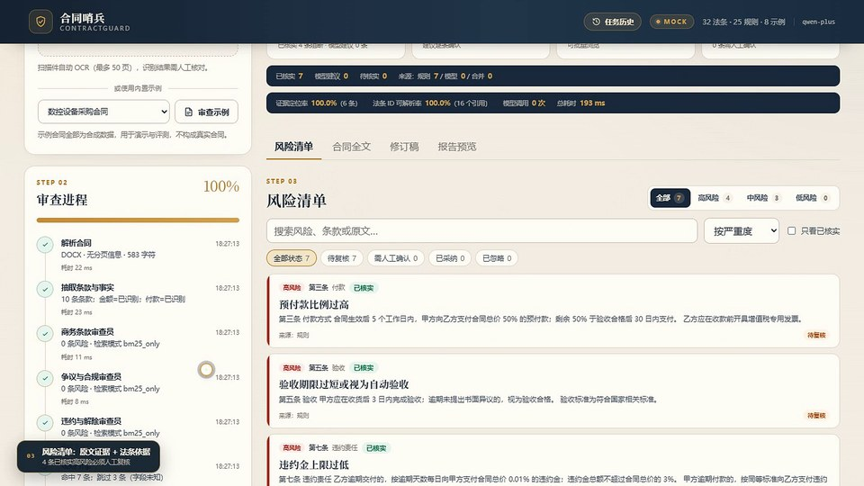

# ContractGuard 面试演示材料

[](./ContractGuard-demo-60s-1080p.mp4)

**[▶ 观看 60 秒 Demo（1080p，男声中文配音）](./ContractGuard-demo-60s-1080p.mp4)**

- 视频：`ContractGuard-demo-60s-1080p.mp4`，1920×1080 / H.264 + AAC / 60.0s / 约 11 MB / 男声中文旁白
- 面试 PPT：`ContractGuard-面试演示.pptx`（14 页，第 13 页内嵌视频 + 男声中文旁白）
- PDF 预览：`ContractGuard-面试演示.pdf`（视频页为静态封面帧）
- 讲解提纲：`讲解提纲.md`（15 分钟节奏、60 秒旁白、Q&A 准备）

## 视频内容

选择内置示例合同 → 规则 + 3 个审查 Agent 并行审查 → 风险清单 → 原文证据/法条详情 → 逐条复核 → 合同修订稿 → 报告预览。

界面为 **mock 模式**录屏；live 指标（P 64.9% / 已核实层 P 100% / 模型建议层 P 7.1%）来自 2026-11-02 的落盘评测结果，两者不混用。

## 在 GitHub 中展示

### 方式一：README 封面 + 链接（已就绪，最稳）

当前目录的 README 已经使用 960px JPEG 封面，点击封面会打开/下载 1080p MP4。把 `docs/interview/` 一起提交到 GitHub 即可。

### 方式二：README 内联播放器（推荐在 GitHub 网页操作）

GitHub 对仓库内的 MP4 链接通常显示为文件页/下载，不保证在 Markdown 中直接内嵌播放器。需要内联播放器时：

1. 在 GitHub 网页打开要展示的 `README.md` 编辑器；
2. 把 `ContractGuard-demo-60s-1080p.mp4` 拖入编辑框，等待 GitHub 上传完成；
3. GitHub 会生成 `https://github.com/user-attachments/assets/...` 资源链接；
4. 用这个链接替换 README 里的相对路径视频链接，提交即可。

### 方式三：GitHub Pages 独立播放页

本目录提供 `index.html` 播放页。启用 GitHub Pages（Source 选择 `/docs`）后，访问：

```text
https://<your-name>.github.io/<repo>/interview/
```

即可看到带播放器、封面、下载链接和一个简短说明的展示页。

## 文件体积

| 文件 | 大小 | 说明 |
|---|---:|---|
| `ContractGuard-demo-60s-1080p.mp4` | ~11 MB | 远低于 GitHub 单文件 100 MB 限制，也低于网页上传 25 MB 限制 |
| `ContractGuard-demo-poster-960.jpg` | ~90 KB | README 封面 |
| `ContractGuard-demo-poster.png` | ~1.1 MB | PPT/PDF 视频封面帧 |
| `ContractGuard-面试演示.pptx` | ~14 MB | 14 页，含内嵌视频 |
| `ContractGuard-面试演示.pdf` | ~2.4 MB | 静态预览 |
